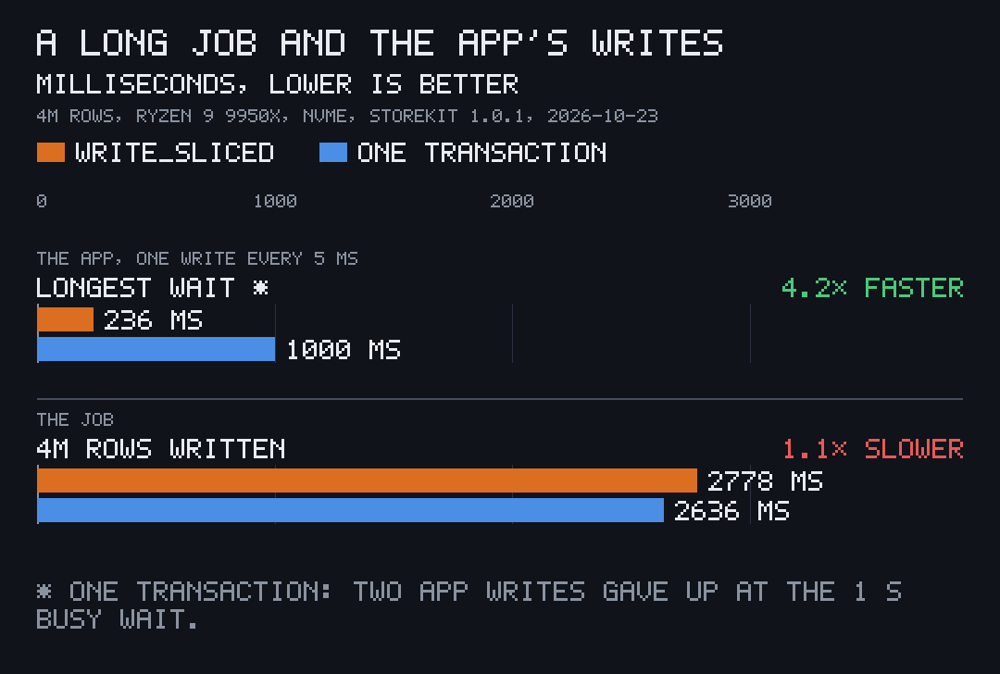
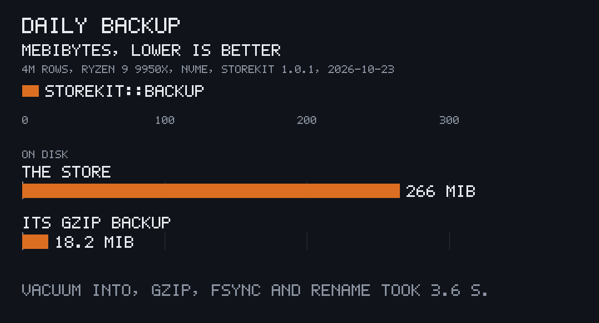

<p align="center"></p>

# pito-storekit

[](https://github.com/gmrdad82/pito-storekit/tags)

The SQLite store underneath [PITO MD](https://pitomd.com) desktop apps, as a
small Rust crate named `storekit`. It is local SQLite storage, not Apple's
StoreKit: it has nothing to do with in-app purchases.

It opens a store with one set of tuned pragmas, runs ordered schema
migrations, writes long background jobs in short slices so the app's own
writes never wait long, keeps a gzip backup a day for 14 days, and names an
app's data and config folders where each OS expects them. It has no app logic
of its own.

Works on Linux and macOS (Windows through WSL).

## At a glance

Measured once on 2026-10-14 with `cargo run --release --example measure`
(storekit 0.1.2, Rust 1.97.1, AMD Ryzen 9 9950X, Samsung 990 PRO NVMe on
btrfs, Linux). The GIF above is a separate run of the same example; the
numbers move a little from run to run.

| | |
|---|---|
| Longest wait for one app write while a 4M-row job runs | **241 ms** with `write_sliced`, none refused; with one transaction two writes gave up after the 1 s busy wait |
| Reopen an already-migrated store | **0.13 ms** (median of 100) |
| Create a new store and migrate it | 74 ms |
| Daily backup of a 265.5 MiB store | **18.2 MiB**, 14.6× smaller, in 3.8 s |
| Code | 608 lines of Rust, tests and blank lines left out |
| Dependencies | 4 direct (`rusqlite` with SQLite built in, `flate2`, `dirs`, `tracing`), 29 crates in the whole build |
| Cold build | 70 s for `cargo build --release --examples`, SQLite's C source included |

## Install and first use

It is not on crates.io: add it from git, pinned to a release tag. You need
Rust 1.97 or newer and a C compiler, since SQLite is compiled into the crate.

**Linux and WSL** (Debian or Ubuntu; any distribution's C toolchain works):

```sh
sudo apt install build-essential
cargo new notes && cd notes
cargo add storekit --git https://github.com/gmrdad82/pito-storekit --tag v1.0.1
```

**macOS:**

```sh
xcode-select --install
cargo new notes && cd notes
cargo add storekit --git https://github.com/gmrdad82/pito-storekit --tag v1.0.1
```

That writes this line to your `Cargo.toml`:

```toml
storekit = { git = "https://github.com/gmrdad82/pito-storekit", tag = "v1.0.1" }
```

Then put this in `src/main.rs` and `cargo run`:

```rust
use storekit::migrate::{Migrations, Step};
use storekit::paths::App;

const APP: App = App { folder: "notes", env_prefix: "NOTES" };

const STEPS: &[Step] = &[
    Step::new(1, "CREATE TABLE IF NOT EXISTS settings (key TEXT PRIMARY KEY, value TEXT NOT NULL);
                  CREATE TABLE notes(id INTEGER PRIMARY KEY, body TEXT NOT NULL);", None),
    Step::new(2, "ALTER TABLE notes ADD COLUMN summary TEXT NOT NULL DEFAULT '';", None),
];

const MIGRATIONS: Migrations = Migrations { version: 2, steps: STEPS, before: None };

fn main() -> Result<(), Box<dyn std::error::Error>> {
    std::fs::create_dir_all(APP.data_dir())?;
    let connection = storekit::open(&APP.db_path("notes.db"), &MIGRATIONS, None)?;
    storekit::settings::set(&connection, "theme", "dark")?;
    let backups = APP.data_dir().join("backups");
    if storekit::backup::due(&backups, APP.folder, now()) {
        storekit::backup::keep(&connection, &backups, APP.folder)?;
    }
    println!("{}", storekit::paths::tilde(&APP.db_path("notes.db").display().to_string()));
    Ok(())
}

fn now() -> i64 {
    std::time::SystemTime::now().duration_since(std::time::UNIX_EPOCH).unwrap().as_secs() as i64
}
```

It prints where the store lives, `~/.local/share/notes-dev/notes.db` on Linux
in a debug build. To see the numbers above on your own machine, clone this
repository and run `cargo run --release --example measure`; it works in a
temporary folder and deletes it when it ends.

## Features

### Long jobs that never lock the app out



SQLite lets one writer in at a time. A background job that imports or
rebuilds in one big transaction holds that lock for seconds, and every write
the app makes meanwhile waits, then fails. `storekit::sliced::write_sliced`
writes the same job in short immediate transactions: 200 ms of work per slice
while the store is quiet, 25 ms for the next 20 slices once another writer is
seen waiting, and a 10 ms breath between slices for the app to get in. Each
committed slice stays committed; a failing item rolls back only its own
slice. `write_sliced_with` takes the budgets as arguments.

```rust
let job: storekit::Db = Arc::new(Mutex::new(storekit::open_companion(&path, None)?));
storekit::sliced::write_sliced(&job, rows, |transaction, row| {
    transaction.execute("INSERT INTO notes(body) VALUES (?1)", [row]).map(|_| ())
})?;
```

In the run above, with the app writing one row every 5 ms during a 4M-row
job, `write_sliced` refused none of the app's writes and the longest waited
241 ms. One transaction finished the job sooner (2.8 s against 3.3 s), but
two of the app's writes gave up at the 1 s busy wait. The median app
write took 0.25 ms against 0.17 ms.

### One way to open a store

`storekit::open(path, migrations, mark)` opens a store in WAL mode with
`synchronous = NORMAL`, foreign keys on, a 32 MiB page cache, 256 MiB of
memory-mapped I/O and a one-second busy wait (`DESK_PEN_WAIT`), then runs the
migrations. Reopening a migrated store took 0.13 ms. `mark` is an optional
SQL profiler hook, and `SLOW_SQL_ALARM` (250 ms) is the threshold the PITO MD
apps use with it. `storekit::open_companion(path, mark)` opens a second
connection for a background worker with the same pragmas and a 30-second busy
wait (`JOB_PEN_WAIT`), and never migrates.

### Ordered migrations

`storekit::migrate` runs `Step`s in the order listed, skips those at or below
the stored version, and records the version in a `schema_meta` table once. A
step can carry a Rust backfill, and `Step::with_foreign_keys_off()` runs a
table rebuild with foreign keys off and turns them back on even when it
fails. `Migrations::before` runs on an existing store before any step.

```rust
const STEPS: &[Step] = &[
    Step::new(1, "CREATE TABLE notes(id INTEGER PRIMARY KEY, body TEXT NOT NULL);", None),
    Step::new(2, "ALTER TABLE notes ADD COLUMN summary TEXT NOT NULL DEFAULT '';", Some(fill_summaries)),
    Step::new(3, "CREATE TABLE notes_new(...); INSERT INTO notes_new SELECT ...;
                  DROP TABLE notes; ALTER TABLE notes_new RENAME TO notes;", None)
        .with_foreign_keys_off(),
];
```

### A gzip backup a day, kept for 14 days



`storekit::backup` keeps one copy a day (by UTC day) as
`<stem>-YYYYMMDD-HHMM.db.gz`: `VACUUM INTO` a plain copy, gzip it, fsync it,
then rename it into place, and delete copies older than 14 days. A half-made
backup never takes a finished name, and files it didn't name are left alone.
`keep` makes one now, `due` and `latest` read the folder, and `spawn` runs a
thread that checks every minute and answers `Handle::status()` and
`Handle::backup_now()`. `storekit::archive::gzip_file(from, into)` gzips one
file and fsyncs the result, as the backups do.

### Folders where each OS expects them


`storekit::paths::App` names an app's folders. The `desk` example above
(`cargo run --example desk`) prints them, opens and migrates its store, seeds
a fixture and keeps the day's backup; a second run finds today's copy already
kept. It writes to your real data folder, which you can delete after.

| | Linux and WSL | macOS |
|---|---|---|
| `config_dir()` | `~/.config/<folder>` | `~/Library/Application Support/<folder>` |
| `data_dir()` | `~/.local/share/<folder>` | `~/Library/Application Support/<folder>` |

A debug build appends `-dev` to the folder, so it never touches a release
build's data. `<PREFIX>_DATA` and `<PREFIX>_DB` override the data folder and
the store's path. `token_path`, `mcp_token_path`, `crash_spool_dir` and
`traces_dir` name the usual files beside them, `set_owner_only_permissions`
makes a file `0600`, and `tilde` shortens a path under the home folder for
display.

### Settings, fixtures and a sandbox guard

- **`storekit::settings`** reads, writes and clears a `settings` key-value
  table (`SETTINGS_TABLE_SQL` creates it).
- **`storekit::fixtures`** seeds a named fixture once when `<PREFIX>_FIXTURES`
  names one, and remembers it in `settings`
  (`PITO_EXAMPLE_FIXTURES=demo cargo run --example desk` seeds three notes).
- **`storekit::rig::guard(app, data_dir)`** refuses to boot (exit 2) when a
  fixture is named but the data folder is not under the folder written in
  `/tmp/.rig`, so test data is only seeded into a sandbox made for it.

## Part of PITO MD

pito-storekit is one of the open Rust libraries behind the
[PITO MD](https://pitomd.com) apps. Its siblings for app plumbing:
[pito-sync](https://github.com/gmrdad82/pito-sync) (a local-SQLite sync
layer), [pito-jobs](https://github.com/gmrdad82/pito-jobs) (live job records
and progress lines), [pito-fetch](https://github.com/gmrdad82/pito-fetch)
(verified, resumable downloads) and
[pito-renew](https://github.com/gmrdad82/pito-renew) (self-update). The GIFs
here are recorded with [prec](https://github.com/gmrdad82/prec) and made GIFs
with pcod from [pito-codecs](https://github.com/gmrdad82/pito-codecs); the
charts are drawn by
[pito-compare](https://github.com/gmrdad82/pito-compare).

## Development

`bin/gate` runs `cargo fmt --check`, `cargo clippy --all-targets -- -D
warnings` and `cargo test`. The tests keep their scratch files in the tree's
`tmp/`. A change merges when `bin/gate` passes on Linux and macOS.

The GIFs are prec shots of the examples (`render/terminal.toml` and
`render/terminal/`), and the charts' data is in `render/charts/`; see
[NOTICE](NOTICE).

The guides are in `docs/pages/`. `bin/docs-bundle vX.Y.Z` packs them with the
`cargo doc` API reference, the changelog and the images into
`tmp/docs-vX.Y.Z.tar.gz`, which is attached to each tag's GitHub Release.

## Contributing

Issues and pull requests are welcome. Please read the
[code of conduct](CODE_OF_CONDUCT.md) first. A change keeps `bin/gate` green
with no warnings. Report a security issue privately, as
[SECURITY.md](SECURITY.md) says, not in a public issue.

## Licence


The code is MIT licensed: see [LICENSE](LICENSE), by Catalin Ilinca. The PITO MD
name, every app and game name and their logos are © Catalin Ilinca, all
rights reserved, and are not covered by the MIT licence: see
[TRADEMARKS.md](TRADEMARKS.md). [NOTICE](NOTICE) says where the images come
from.
